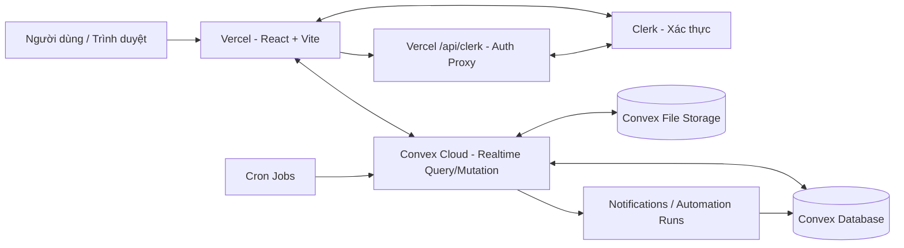

# CloudTask Pro — Cloud Task Management System

> Ứng dụng quản lý công việc trên nền tảng đám mây, hỗ trợ cộng tác theo Workspace, quản lý dự án bằng Kanban, đồng bộ thời gian thực và tự động cảnh báo deadline.

[](https://react.dev/)
[](https://www.typescriptlang.org/)
[](https://vite.dev/)
[](https://www.convex.dev/)
[](https://vercel.com/)

## Truy cập nhanh

- **Demo hoạt động (Vercel Preview):** https://cloud-task-manager-git-feature-ui-profile-polish-phan18.vercel.app/
- **Mã nguồn:** https://github.com/PhanHoang12/cloud-task-manager
- **Production URL (chưa nghiệm thu xác thực):** https://cloud-task-manager-ten.vercel.app/

> **Trạng thái triển khai (28/10/2026):** Bản Preview đã được kiểm tra qua luồng Workspace → Project → Task và mở Automation Dashboard. Bản Production đã deploy và xác minh Clerk Proxy, nhưng đăng ký/đăng nhập còn lỗi; **hãy dùng link Preview để demo**. Các bài kiểm thử tự động hiện có: 7/7 PASS. Không nên tuyên bố mọi chức năng đã được kiểm thử thực tế.

## 1. Tổng quan

CloudTask Pro được phát triển phục vụ đồ án môn **Điện toán đám mây**. Ứng dụng cho phép người dùng tổ chức công việc cá nhân và theo nhóm, phân quyền truy cập, theo dõi tiến độ dự án, trao đổi trên từng task và nhận cảnh báo deadline từ hệ thống tự động hóa phía máy chủ.

### Chức năng chính

| Nhóm | Khả năng |
| --- | --- |
| Xác thực | Đăng ký, đăng nhập, quản lý phiên với Clerk; tách môi trường Development/Production |
| Công việc cá nhân | Tạo, cập nhật, lọc công việc và quản lý hạn hoàn thành |
| Workspace & Project | Tạo không gian làm việc, dự án, trạng thái dự án và dashboard tổng quan |
| Phân quyền RBAC | `owner`, `admin`, `member`, `viewer`; kiểm tra quyền tại Convex mutations/queries |
| Cộng tác | Mời thành viên, quản lý vai trò, nhận thông báo, xem hoạt động |
| Kanban | `todo`, `in_progress`, `review`, `done`; đổi trạng thái bằng kéo-thả hoặc lựa chọn |
| Task nâng cao | Mức ưu tiên, deadline, người phụ trách, checklist/subtasks, bình luận |
| Tự động hóa | Cron quét deadline, thông báo sắp đến hạn/quá hạn, chống trùng cảnh báo |
| Theo dõi Automation | Thống kê thời gian thực, lịch sử thực thi có hạn chế truy cập, watchdog |
| Hồ sơ cá nhân | Cập nhật thông tin, ảnh đại diện được lưu bằng Convex File Storage |
| Giao diện | Responsive sidebar, thao tác nhất quán, thông báo trạng thái và xác nhận khi xóa |

## 2. Công nghệ

- **Frontend:** React 19, Vite 6, TypeScript, CSS, lucide-react.
- **Authentication:** Clerk (`@clerk/react`), tích hợp JWT với Convex.
- **Backend & Database:** Convex (Query, Mutation, Action, Scheduler/Cron, File Storage, Realtime).
- **HTTP endpoint:** Convex HTTP Actions cho chức năng tải ảnh đại diện; Vercel Serverless Function `api/clerk.js` phục vụ Clerk Frontend API Proxy.
- **Triển khai:** Vercel (frontend và proxy), Convex Cloud (backend và dữ liệu).
- **Kiểm thử:** TypeScript build, Vitest, `convex-test`.

## 3. Sơ đồ kiến trúc



**Luồng dữ liệu:** (1) trình duyệt tải SPA từ Vercel; (2) Clerk xác thực và cấp JWT; (3) Convex kiểm tra danh tính và quyền trên máy chủ; (4) Convex Query/Mutation đồng bộ kết quả đến các client đang subscribe; (5) Cron chạy phía backend và ghi thông báo; (6) avatar được gửi đến HTTP Action có kiểm tra xác thực, nguồn gốc, loại file và kích thước.

> Clerk Development, Clerk Production, Convex Development, Convex Preview và Convex Production là **các môi trường độc lập**. Không trộn lẫn publishable key, secret key, Convex URL hoặc deploy key giữa các môi trường.

## 4. Yêu cầu cài đặt

- Node.js **22 LTS** (hoặc bản Node.js tương thích với các dependency đang khóa trong `package-lock.json`).
- npm và Git.
- Tài khoản Clerk, Convex và Vercel.
- Quyền cấu hình môi trường trong Clerk/Convex/Vercel tương ứng.

## 5. Chạy trên máy cá nhân

```bash
git clone https://github.com/PhanHoang12/cloud-task-manager.git
cd cloud-task-manager
npm ci
```

Tạo `.env.local` ở thư mục gốc, dựa trên `.env.example`:

```dotenv
# Convex CLI sẽ tự tạo/cập nhật các giá trị deployment phù hợp
CONVEX_DEPLOYMENT=dev:<ten-deployment-cua-ban>
VITE_CONVEX_URL=https://<deployment>.<region>.convex.cloud
VITE_CONVEX_SITE_URL=https://<deployment>.<region>.convex.site

# Clerk Development publishable key, từ Clerk Dashboard
VITE_CLERK_PUBLISHABLE_KEY=pk_test_...

# Chỉ thiết lập khi dùng proxy và đúng cấu hình môi trường
# VITE_CLERK_PROXY_URL=https://<your-domain>/__clerk
```

> Không đưa `CLERK_SECRET_KEY`, `CONVEX_DEPLOY_KEY` hay giá trị `.env.local` vào Git. `VITE_` là biến được đóng gói vào frontend, **không dùng cho secret**.

Tại Clerk Dashboard, bật tích hợp **Convex** cho instance phù hợp. Cấu hình issuer/JWT theo `convex/auth.config.ts` của dự án và thiết lập môi trường Convex tương ứng. Ví dụ:

```bash
npx convex dev
```

Mở terminal thứ hai:

```bash
npm run dev
```

Truy cập `http://localhost:5173`.

### Biến môi trường backend Convex

| Tên biến | Mục đích | Ghi chú |
| --- | --- | --- |
| `CLERK_FRONTEND_API_URL` | Clerk issuer / frontend API URL cho `convex/auth.config.ts` | Theo từng deployment; không được lẫn Development/Production |
| `AVATAR_ALLOWED_ORIGIN` | Origin cho phép upload avatar qua HTTP Action | Ví dụ local `http://localhost:5173`, Preview/Production phải là URL thực tế |
| `AUTOMATION_HISTORY_ADMIN_ID` | Clerk user ID được đọc lịch sử automation toàn hệ thống | Tùy chọn; không dùng user ID môi trường khác |

Ví dụ cấu hình tại **Convex Development**:

```bash
npx convex env set AVATAR_ALLOWED_ORIGIN "http://localhost:5173"
# Thay URL bằng giá trị thực tế từ Clerk Development của bạn:
npx convex env set CLERK_FRONTEND_API_URL "https://<your-clerk-development-domain>"
```

Không tự động chạy `npx convex deploy --prod` khi chưa xác minh deployment đích.

## 6. Các lệnh phát triển và kiểm thử

```bash
npm run dev        # Vite development server
npm run build      # TypeScript + Vite production build
npm run preview    # Xem thử bản build local
npm run check      # Kiểm tra TypeScript
npm test           # Vitest unit tests
npx convex dev     # Đồng bộ Convex development
```

**Kết quả đã kiểm chứng:** Build thành công; 7/7 unit tests PASS đối với workspace membership và profile synchronization. Các chức năng như Cron, upload avatar, kéo-thả Kanban cần được kiểm thử tích hợp riêng trước khi khẳng định PASS toàn bộ.

## 7. Cấu trúc dự án

```text
cloud-task-manager/
├── api/
│   └── clerk.js                   # Clerk Frontend API Proxy (Vercel Function)
├── convex/
│   ├── schema.ts                  # Database schema và indexes
│   ├── auth.config.ts             # Clerk / Convex auth
│   ├── workspaces.ts, projects.ts # Workspace, Project, RBAC
│   ├── members.ts, invitations.ts # Thành viên và lời mời
│   ├── projectTasks.ts            # Kanban project tasks
│   ├── subtasks.ts, comments.ts   # Checklist và thảo luận
│   ├── notifications.ts           # Thông báo
│   ├── profiles.ts                # Hồ sơ và avatar metadata
│   ├── http.ts                    # HTTP Action /upload-avatar
│   ├── automation.ts              # Deadline processing
│   ├── automationStats.ts         # Analytics realtime
│   ├── automationHistory.ts       # Lịch sử automation
│   ├── automationWatchdog.ts      # Phát hiện worker chạy quá lâu
│   └── crons.ts                   # Định nghĩa Cron Jobs
├── src/
│   ├── App.tsx, main.tsx          # App shell, providers
│   ├── components/                # Feedback và UI chung
│   └── features/
│       ├── kanban/                # Kanban, analytics, notifications
│       ├── profile/               # Hồ sơ cá nhân
│       └── workspaces/            # Workspace và team
├── vercel.json                    # Rewrites cho SPA và Clerk Proxy
├── .env.example                   # Biến môi trường mẫu (không chứa secret)
└── package.json
```

## 8. Triển khai Vercel + Convex

1. Push code lên GitHub và kết nối repository với Vercel.
2. Framework Preset chọn **Vite**, Output Directory `dist`.
3. Cấu hình Build Command đang sử dụng:

   ```bash
   npx convex deploy --cmd "npm run build" --cmd-url-env-var-name VITE_CONVEX_URL
   ```

4. Khai báo Vercel Environment Variables theo môi trường:

   | Biến | Preview | Production |
   | --- | --- | --- |
   | `CONVEX_DEPLOY_KEY` | Deploy key dành cho Preview | Deploy key Production |
   | `VITE_CLERK_PUBLISHABLE_KEY` | `pk_test_...` | `pk_live_...` |
   | `CLERK_PUBLISHABLE_KEY` | `pk_test_...` (nếu dùng proxy) | `pk_live_...` |
   | `CLERK_SECRET_KEY` | `sk_test_...` (Secret) | `sk_live_...` (Secret) |
   | `VITE_CLERK_PROXY_URL` | Tùy triển khai; dùng origin Preview thực tế | `https://cloud-task-manager-ten.vercel.app/__clerk` |

5. Thiết lập `CLERK_FRONTEND_API_URL` và `AVATAR_ALLOWED_ORIGIN` **trong Convex deployment đích**, không phải trong Vercel.
6. Với ứng dụng React SPA, `vercel.json` chứa rewrite để chuyển Clerk Proxy đến `/api/clerk` và các route frontend về `index.html`.
7. Redeploy sau khi sửa Environment Variables; kiểm tra Build Logs, Functions và Convex Dashboard.

**Giới hạn quan trọng:** `*.vercel.app` trên Clerk Production có thể gặp vấn đề với phiên đăng nhập/cookie dù proxy xác minh thành công. Trong đồ án này, link Preview + Clerk Development hiện được sử dụng làm demo hoạt động; Production **chưa được nghiệm thu xác thực**. Để vận hành Production dài hạn, nên dùng domain do bạn sở hữu và cấu hình đầy đủ Clerk OAuth/cookie.

## 9. Luồng xử lý chính

### Xác thực và phân quyền

1. Người dùng đăng nhập qua Clerk.
2. React nhận trạng thái xác thực và cấp token cho Convex client.
3. Convex lấy `ctx.auth.getUserIdentity()` để xác định danh tính.
4. Query/Mutation kiểm tra workspace membership, role và trạng thái project trên máy chủ; UI không thay thế bước kiểm tra quyền.

### Realtime Kanban

1. Component đăng ký Convex Query để nhận danh sách task.
2. Người dùng thay đổi trạng thái task hoặc thêm bình luận/subtask.
3. Mutation xác thực quyền và cập nhật database.
4. Convex tự gửi dữ liệu mới đến các client đang subscribe; giao diện cập nhật mà không cần reload.

### HTTP Action tải avatar

- Route `POST /upload-avatar` được triển khai trên Convex HTTP Actions domain (`*.convex.site`).
- Backend xác thực Clerk Bearer token và kiểm tra `Origin` theo `AVATAR_ALLOWED_ORIGIN`.
- File chỉ chấp nhận JPG/PNG/WebP, tối đa 2 MB; xác minh metadata và chữ ký nội dung cơ bản.
- Lưu ảnh trong Convex File Storage, sau đó ghi `avatarStorageId`/`avatarUrl` vào `profiles` bằng internal mutation.

### Cron Jobs và Deadline Automation

- `scan-task-deadlines`: chạy mỗi **15 phút**, phát hiện task sắp hạn/quá hạn và phát thông báo có cơ chế chống trùng.
- `check-stale-automation-runs`: chạy mỗi **5 phút**, ghi nhận các phiên xử lý vượt ngưỡng (watchdog).
- Automation Dashboard tổng hợp thống kê; lịch sử hệ thống được giới hạn quyền truy cập.
- Cron thực thi trên Convex backend, **không phụ thuộc trình duyệt người dùng có đang mở hay không**.

## 10. Quy trình demo đề xuất

1. Mở **link Preview** và đăng nhập Clerk Development.
2. Tạo Workspace và Project, quan sát chỉ số dashboard.
3. Tạo task trên Kanban với mức ưu tiên và deadline.
4. Chuyển trạng thái task, thử checklist/bình luận.
5. Mở Automation Dashboard để quan sát dữ liệu thống kê.
6. Trình bày cấu trúc Convex schema, quyền RBAC và Cron Jobs trong dashboard.

## 11. Bảo mật và lưu ý

- Không commit `.env.local`, `.vercel/`, secret keys hoặc token.
- Phải kiểm tra quyền ở Convex server functions, không tin cậy role do client gửi lên.
- Giới hạn kích thước và loại file khi upload; xác thực HTTP Action.
- Preview là môi trường demo; không dùng Clerk Development làm ứng dụng công khai phục vụ người dùng thực.
- Backup dữ liệu Convex trước thay đổi lớn về schema hoặc xoá dữ liệu.
- Link demo có thể thay đổi theo nhánh, cài đặt bảo vệ hoặc trạng thái deployment của Vercel.

## 12. Tài liệu tham khảo

- [React](https://react.dev/) · [Vite](https://vite.dev/) · [TypeScript](https://www.typescriptlang.org/)
- [Clerk React](https://clerk.com/docs) · [Convex Documentation](https://docs.convex.dev/)
- [Vercel Documentation](https://vercel.com/docs)

---

**CloudTask Pro** — Đồ án môn Điện toán đám mây · Cập nhật: 28/10/2026.
